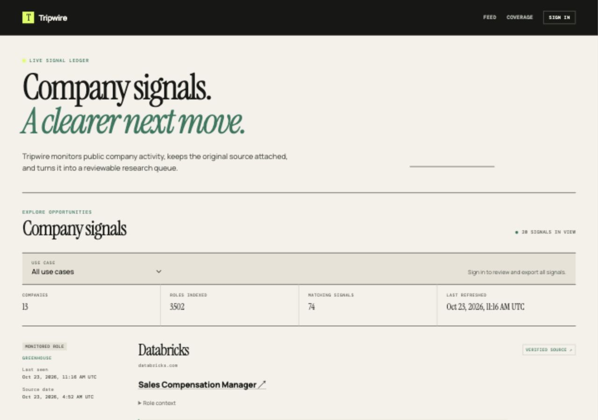

# Tripwire

[](https://github.com/miggy-code/Tripwire/actions/workflows/ci.yml)

**Find the operational changes worth starting a conversation about.**

Tripwire monitors company job boards and turns hiring evidence into a research feed organized by use case. Identify manual reporting workflows, systems integration work, and modernization initiatives, then follow the exact source behind each signal.

Built with **Next.js, PostgreSQL, and Clerk**.



## The product

- **Source-backed signals.** Every result connects a company and role to the relevant excerpt, source listing, and discovery question.
- **Reusable use cases.** Versioned profiles for AI automation and technology modernization run against the same collected catalog.
- **Continuous monitoring.** Scheduled collection tracks new listings, edits, and removals while retaining observation history.
- **Authenticated workspaces.** Clerk handles sign-in and optional organization workspaces. Members can review signals, record relevance feedback, and export CSV.
- **Company coverage.** Browse monitored companies, indexed roles, and the freshness of each company’s data.

## How it works

```text
Company job boards → Collection worker → PostgreSQL observation history
                                                ↓
                                       Versioned use-case profiles
                                                ↓
                                    Review feed · Feedback · CSV
```

Ashby and Greenhouse boards populate the configured catalog; a Lever adapter is also included. Company identities link to verified career pages. Each collection runs with bounded retries and per-board transactions, preserving existing records when a source is unavailable. Initial snapshots are distinguished from changes observed after monitoring begins.

Profiles define evidence terms, context exclusions, recommended next steps, and discovery questions. Results retain their source context so reviewers can assess the opportunity directly.

## Run locally

Requires Node.js 24+, PostgreSQL 15+, and a Clerk application.

```sh
npm ci
cp .env.example .env.local
```

Create a database, then configure these values in `.env.local`:

| Variable | Value |
| --- | --- |
| `DATABASE_URL` | Your PostgreSQL connection string |
| `APP_URL` | `http://127.0.0.1:3000` |
| `NEXT_PUBLIC_CLERK_PUBLISHABLE_KEY` | Your Clerk publishable key |
| `CLERK_SECRET_KEY` | Your Clerk secret key |

The remaining Clerk route settings are supplied in `.env.example`. Enable Organizations in Clerk for team workspaces, with organization selection optional.

```sh
npm run db:migrate
npm run collect
npm run dev
```

Open [localhost:3000](http://127.0.0.1:3000). Start recurring collection in another terminal:

```sh
npm run worker
```

Collection runs every six hours by default. Set `COLLECTION_INTERVAL_MINUTES` to change the interval. Keep credentials in your private environment file.

## Configure a use case

Add or edit a JSON profile in `profiles/`. A profile contains its name, version, evidence rules, sentence exclusions, and excluded role titles. Each rule specifies matching terms, a label, a suggested next step, and a question for discovery.

Manage monitored companies and verified board mappings in `config/companies.json`. Collection and profile evaluation are independent: a new use case can reuse the existing observation history.

## Architecture

| Layer | Implementation |
| --- | --- |
| Application | Next.js App Router, React, TypeScript |
| Identity | Clerk sessions and optional organizations |
| Persistence | PostgreSQL, migrations, historical observation versions |
| Collection | Source adapters, retries, advisory locking, recurring worker |
| Evaluation | Versioned JSON profiles with source excerpts |
| Operations | Public health endpoint, source status, authenticated collection controls |
| Delivery | Protected feed and CSV export |

Workspace identity is derived from verified server-side sessions. Feedback is scoped to the signed-in member within their workspace. Global collection requires an explicitly allowlisted operator or a scheduler bearer token.

## Development

```sh
npm test
npm run check
npm run build
```

To include PostgreSQL integration tests, set `TEST_DATABASE_URL` to a dedicated database with a name ending in `_test`. The test suite resets that database.

An additional development-only Clerk integration verifier is available:

```sh
node --env-file=.env.local test/clerk-live.mjs
```

CI runs tests, TypeScript checks, and a production build. See [engineering notes](docs/ENGINEERING.md) for verification scope, API contracts, and operational configuration.

## Project structure

```text
app/          Pages, workspace interface, and API routes
src/          Collection, persistence, evaluation, and worker
profiles/     Versioned use-case definitions
config/       Company catalog and integration configuration
test/         Collector, profile, database, and access-control checks
docs/         Architecture, engineering notes, and implementation plan
```
